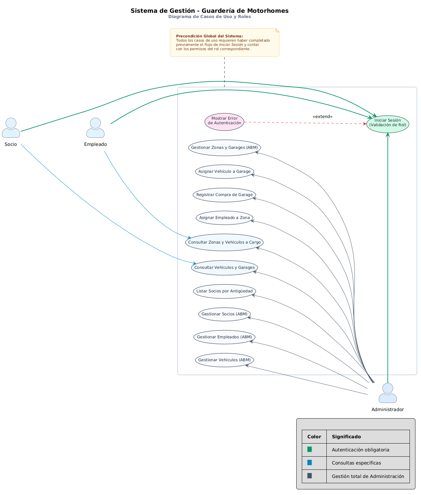
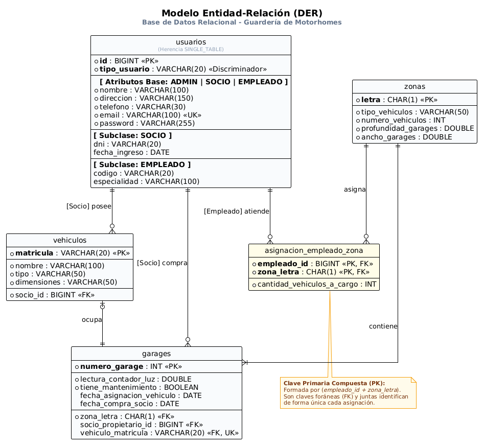
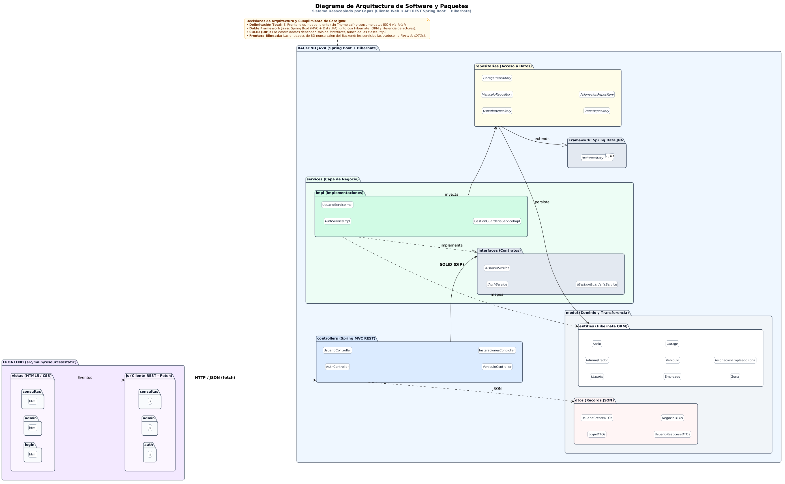
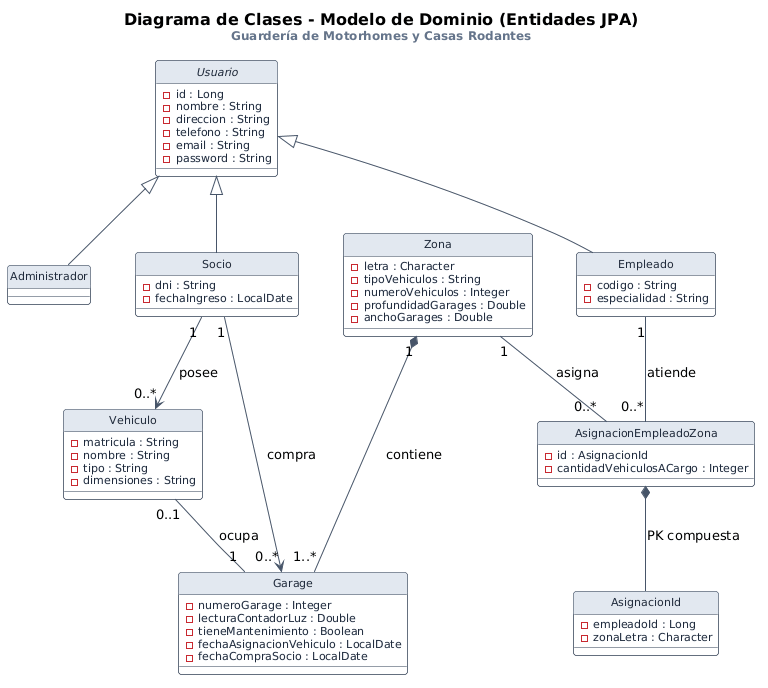

# 🚐 Sistema de Gestión - Guardería "Ayres de Etcheverry"

> Sistema web full-stack con arquitectura 100% desacoplada (API REST en Java Spring Boot + Cliente Web Vanilla JS/Bootstrap) para la administración integral de instalaciones, zonas, garages, socios, empleados y vehículos recreativos (motorhomes, casas rodantes, caravanas y trailers).

---

## 📋 Descripción del Proyecto
Este proyecto corresponde al **Trabajo Práctico Final** de la materia **Programación 2** (*Tecnicatura Superior en Informática Aplicada - INSPT - UTN*).

El sistema digitaliza y automatiza la gestión operativa de la guardería **Ayres de Etcheverry**. Está diseñado bajo una estricta **separación entre Backend y Frontend** (sin motores de plantillas del lado del servidor como Thymeleaf): el servidor expone una **API RESTful** en formato JSON y el cliente consume dichos *endpoints* de forma asíncrona desde el navegador. Permite administrar el ciclo de vida completo (ABM funcionales) de socios, vehículos, asignación de garages por zona, lectura de consumo eléctrico, servicios de mantenimiento, propiedad de garages y asignación de empleados.

### 👥 Actores del Sistema (Roles)
El acceso al sistema está segmentado en **3 roles diferenciados**, controlados dinámicamente en el cliente según el perfil autenticado:
* **Administrador:** Control total sobre el sistema. Gestiona altas, bajas y modificaciones (ABM) de socios, vehículos, garages, zonas y empleados. Además, dispone de reportes y listados filtrados (por ejemplo, listado de socios ordenados por antigüedad).
* **Socio:** Acceso de consulta sobre su información personal, sus vehículos registrados, los garages que tiene asignados o en propiedad (con fechas de compra/asignación) y el estado de sus servicios.
* **Empleado:** Acceso de consulta sobre las zonas a las que fue asignado, su especialidad y el detalle de los vehículos bajo su responsabilidad en cada sector.

---

## 🛠️ Tecnologías y Frameworks Utilizados

### Backend (API REST)
* **Lenguaje:** Java [25]
* **IDE:** IntelliJ IDEA
* **Frameworks:**
    * **Spring Boot** (Spring Web / `@RestController`)
    * **Spring Data JPA / Hibernate** (Persistencia ORM)
    * *[Agregar Spring Security / Lombok / Validation si los utilizaron]*
* **Base de Datos Relacional:** [MySQL]
* **Gestor de Dependencias:** [Maven]

### Frontend (100% Desacoplado - Lado del Cliente)
* **HTML5:** Estructura semántica de las vistas (`index.html`, `login.html`, `admin.html` y `consultas.html`).
* **CSS3 y Bootstrap 5 (Local):** Diseño responsivo, grillas, pestañas, tarjetas, tablas y alertas visuales, alojado localmente en `static/css` y `static/js` para funcionar sin conexión a internet.
* **JavaScript Vanilla (ES6+):** Organizado en módulos independientes (`auth.js`, `admin.js` y `consultas.js`) para manejar la lógica de interfaz y la manipulación dinámica del DOM.
* **Fetch API (HTTP / JSON):** Comunicación asíncrona (`GET`, `POST`, `PUT`, `DELETE`) contra los *endpoints* REST de Spring Boot.
* **Web Storage API (`localStorage`):** Gestión de sesión del usuario autenticado (`id`, `nombre`, `email` y `rol`) en el navegador para controlar accesos y vistas según el rol.

---

## 🏗️ Arquitectura del Proyecto
El desarrollo está estructurado bajo una **arquitectura en capas** respetando los pilares de la Programación Orientada a Objetos (abstracción, encapsulamiento, herencia y polimorfismo), los principios **SOLID** y el patrón **DTO**:

### Capas del Backend (`src/main/java/...`)
* **`controller/`**: Controladores REST (`@RestController`) encargados de recibir peticiones HTTP y devolver respuestas estructuradas en formato JSON.
* **`service/`**: Lógica de negocio, reglas de validación (capacidad de zonas, asignación única de garages, cálculo de antigüedad) y mapeo entre Entidades y DTOs.
* **`repository/`**: Interfaces que extienden de Spring Data JPA para la persistencia y consultas en la base de datos relacional.
* **`model/` (Entidades)**: Clases del dominio (`Usuario`, `Administrador`, `Socio`, `Empleado`, `Vehiculo`, `Garage`, `Zona`, `AsignacionEmpleadoZona`, etc.) mapeadas con JPA/Hibernate.
* **`dto/`**: Objetos de transferencia de datos (*Request/Response DTOs*) para proteger las entidades de la base de datos y definir contratos claros de entrada y salida.

### Estructura del Cliente (`src/main/resources/static/`)
* **Vistas HTML:** `index.html`, `login.html`, `admin.html`, `consultas.html`.
* **Scripts JS:** `auth.js` (autenticación y manejo de `localStorage`), `admin.js` (operaciones ABM para administradores), `consultas.js` (vistas de consulta para socios y empleados).
* **Recursos locales:** `css/` y `js/` (Bootstrap 5 local y estilos propios).

---

## 📊 Diagramas del Sistema

### 1. Diagrama de Casos de Uso


### 2. Diagrama Entidad-Relación (DER)


### 3. Arquitectura General por Paquetes


### 4. Diagrama de Clases (Entidades del Dominio)


*(Los diagramas complementarios sobre **DTOs** y el **flujo particular de la entidad Socio** se encuentran almacenados en la carpeta [`docs/`](docs/) y detallados en el informe de evaluación).*

---

## 🚀 Cómo Ejecutar el Proyecto Localmente

### Prerrequisitos
* **JDK [25]** instalado.
* Motor de base de datos **[MySQL]** activo.
* **IntelliJ IDEA** (o terminal con Maven).
* Navegador web moderno (Chrome).

### Pasos de instalación
1. **Clonar el repositorio:**
   ```bash
   git clone https://github.com/anto-puca/SistemaGuarderia.git
   ```
2. **Configurar la base de datos:**
    * Crear una base de datos vacía llamada `guarderia_db`.
    * Configurar las credenciales en `src/main/resources/application.properties`:
      ```properties
      spring.datasource.url=jdbc:mysql://127.0.0.1:3306/guarderia_db
      spring.datasource.username=root
      spring.datasource.password=admin
      spring.jpa.hibernate.ddl-auto=update
      ```
3. **Ejecutar la aplicación:**
    * Abrir el proyecto en **IntelliJ IDEA** y aguardar la descarga de dependencias.
    * Ejecutar la clase principal `[GuarderiaApplication].java`.
    * Abrir el navegador web e ingresar a: `http://localhost:8080`.

---

## 📄 Documentación Completa
El documento formal de evaluación con la portada institucional, arquitectura detallada, descripción de tablas y manual de usuario con capturas de pantalla se encuentra disponible en:
* 📑 [Ver Documento de Evaluación (PDF)](docs/documentacion_proyecto.pdf)

---

## 👨‍💻 Integrantes del Grupo
* **[Antonia Puca ]** - [@anto-puca](https://github.com/anto-puca/SistemaGuarderia.git)

